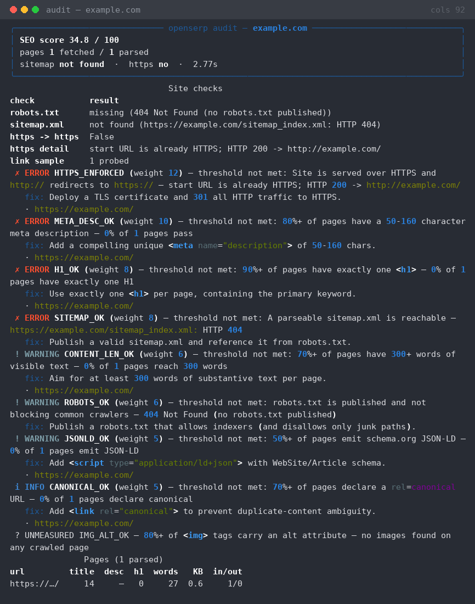
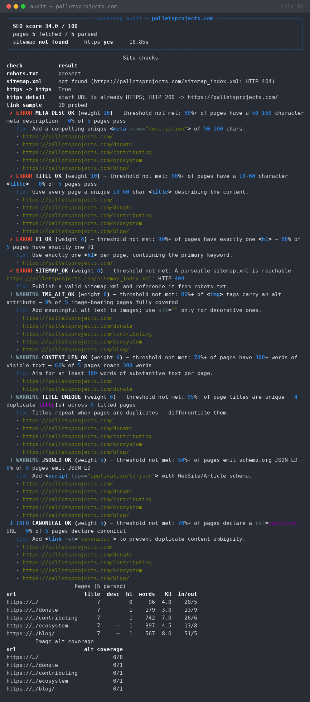
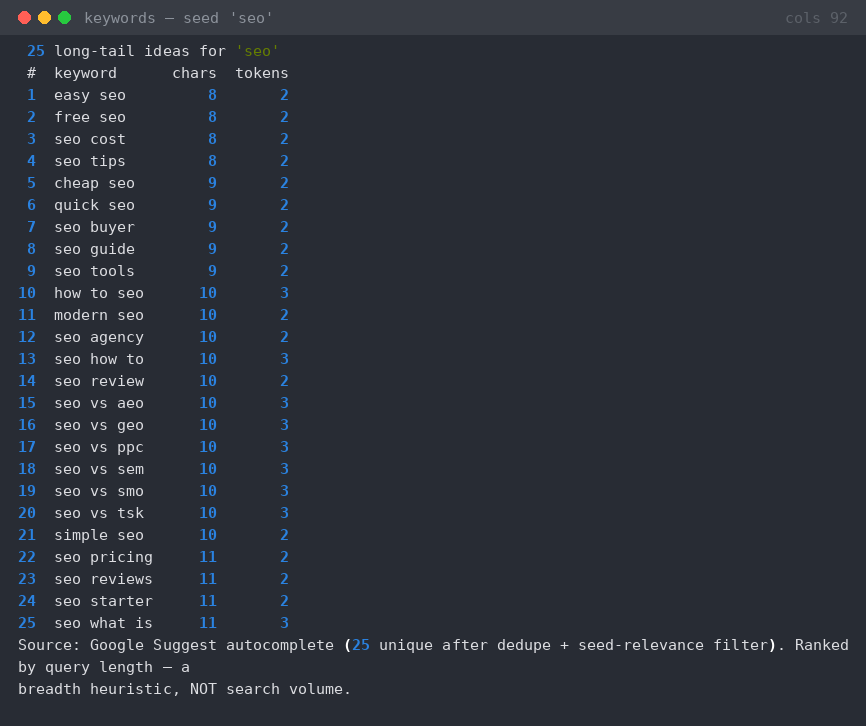

<div align="center">

**English** · [Türkçe](README_tr.md) · [Français](README_fr.md) · [Deutsch](README_de.md) · [Español](README_es.md)

# OpenSERP

### Open-source SEO research & site-audit toolkit. Real crawls, real SERPs, real scores.

**Every score is reproducible. Every rule is readable. No API keys, no mocked data, no black-box algorithms.**

[](https://github.com/0xshaikh/openserp/actions/workflows/ci.yml)
[](https://www.python.org/)
[](LICENSE)
[]()
[]()
[]()

[Quick start](#quick-start) · [Features](#features) · [The rubric](#the-audit-rubric-is-auditable) · [Architecture](#architecture) · [Roadmap](#roadmap) · [Contributing](#contributing)

<br />

<code>pip install openserp && openserp audit https://example.com</code>

<br />


</div>

---

SEO research normally requires a multi-terabyte crawled index and a subscription to access it. OpenSERP gives you the parts that genuinely work from live HTTP requests your machine makes right now — **site audits, keyword discovery, rank tracking, and verified backlink discovery** — with every figure reproducible and every rule readable in source.

No numbers from a black box. No "check your dashboard" dead ends. OpenSERP prints the exact rules, their weights, their thresholds, and the URLs that failed — so you can argue with the score.

## Features

| Command | What it runs |
|---|---|
| `audit` | Real BFS crawler (same-domain, robots.txt-aware, rate-limited) + 13 on-page/technical checks + 0–100 weighted rubric |
| `keywords` | Google Suggest autocomplete across curated prefix/suffix/question modifiers, deduped and seed-relevance filtered |
| `rank` | DuckDuckGo HTML SERP parse → position of your domain, top-N competitors, persisted to SQLite for history |
| `backlinks` | Live search operators + **fetches each candidate page and verifies it really links** |
| `compete` | audit + keywords + rank → one competitor profile `.md` |
| `serve` | Local Flask dashboard: paste a URL, get the score and issue table in a browser |

## The audit rubric is auditable

Weights sum to exactly **100** and are declared in one table in [`openserp.py`](./openserp.py):

| Rule | Weight | Severity | Checks |
|---|---:|---|---|
| `HTTPS_ENFORCED` | 12 | error | HTTPS served, `http://` redirects to `https://` |
| `META_DESC_OK` | 10 | error | ≥80% of pages, 50–160 chars |
| `TITLE_OK` | 10 | error | ≥90% of pages, 10–60 chars |
| `LINKS_HEALTHY` | 10 | error | ≥90% of a sampled link set returns 2xx/3xx |
| `H1_OK` | 8 | error | ≥90% of pages, exactly one `<h1>` |
| `SITEMAP_OK` | 8 | error | Parseable sitemap reachable |
| `IMG_ALT_OK` | 8 | warning | ≥80% of `` tags carry alt |
| `CONTENT_LEN_OK` | 6 | warning | ≥70% of pages have 300+ words |
| `ROBOTS_OK` | 6 | warning | robots.txt published and not blocking |
| `REDIRECTS_CLEAN` | 6 | warning | No page needs more than 2 redirect hops |
| `TITLE_UNIQUE` | 6 | warning | ≥95% of page titles are unique |
| `JSONLD_OK` | 5 | warning | ≥50% of pages emit schema.org JSON-LD |
| `CANONICAL_OK` | 5 | info | ≥70% of pages declare `rel=canonical` |

## Quick start

### Install from source (recommended)

```bash
git clone https://github.com/0xshaikh/openserp.git
cd openserp
pip install -e .                # or: pip install -e ".[serve]" for the dashboard
openserp --version
```

### Run one command without installing

```bash
python3 -m pip install requests beautifulsoup4 lxml rich click
python3 <(curl -sL https://raw.githubusercontent.com/0xshaikh/openserp/main/openserp.py) \
    audit https://example.com
```

Python 3.10+. Five runtime dependencies (`requests`, `beautifulsoup4`, `lxml`, `rich`, `click`). `flask` is optional and only needed for `serve`.

### Requirements

- Python 3.10 or newer
- 5 runtime dependencies (all pure Python, no compilation)
- Optional: Flask 3.0+ for the `serve` dashboard

## Usage

### `audit` — crawl, check, score

```bash
openserp audit https://example.com --max-pages 20 --link-probes 25
```

Output includes:
- **Overall score** (0–100, weighted rubric)
- **Per-rule breakdown** with pass/fail and exact thresholds
- **Failed URLs** for every rule that didn't pass
- **Crawl stats** — pages visited, links followed, time taken

#### Options

| Flag | Default | Description |
|---|---:|---|
| `--max-pages` | 25 | Max pages to crawl (same domain) |
| `--link-probes` | 25 | Max external links to probe for health |
| `--output` | `terminal` | `terminal`, `json`, `csv`, or `markdown` |
| `--no-crawl` | | Audit only the given URL, don't crawl |
| `--fail-below` | | Exit non-zero if score is below this threshold |

Real captured output:

```
╭──────────────────────── openserp audit — example.com ────────────────────────╮
│ SEO score 34.8 / 100                                                         │
│ pages 1 fetched / 1 parsed                                                   │
│ sitemap not found  ·  https no  ·  2.34s                                     │
╰──────────────────────────────────────────────────────────────────────────────╯
                                Site checks
check           result
robots.txt      missing (404 Not Found (no robots.txt published))
sitemap.xml     not found (https://example.com/sitemap_index.xml: HTTP 404)
https -> https  False
link sample     1 probed
 ✗ ERROR HTTPS_ENFORCED (weight 12) — start URL is already HTTPS; HTTP 200
-> http://example.com/
   fix: Deploy a TLS certificate and 301 all HTTP traffic to HTTPS.
   · https://example.com/
 ✗ ERROR META_DESC_OK (weight 10) — 0% of 1 pages pass
   fix: Add a compelling unique <meta name="description"> of 50-160 chars.
 ✗ ERROR SITEMAP_OK (weight 8) — https://example.com/sitemap_index.xml: HTTP 404
   fix: Publish a valid sitemap.xml and reference it from robots.txt.
 ? UNMEASURED IMG_ALT_OK — no images found on any crawled page
               Pages (1 parsed)
url         title  desc  h1  words   KB  in/out
https://…/     14     —   0     27  0.6     1/0
```

The `? UNMEASURED` row is deliberate: with no images on the page the alt-tag
rule cannot be judged, so it is reported as unmeasurable rather than scored as
a pass.

`json`/`csv`/`markdown` output goes to **raw stdout** — never wrapped in a
styled panel, never re-wrapped at the terminal width — so it is safe to pipe,
and every progress/status/gate message goes to stderr instead:

```bash
openserp audit https://example.com --output json | jq '.score'
openserp audit https://example.com --output csv | python -c 'import csv,sys; print(len(list(csv.DictReader(sys.stdin))))'
```

### `keywords` — real long-tail expansion

```bash
openserp keywords seo --count 25
```

```
25 long-tail ideas for 'seo'
 #  keyword     chars  tokens
 1  easy seo         8       2
 2  free seo         8       2
 3  seo cost         8       2
 4  seo tips         8       2
 5  cheap seo        9       2
 6  quick seo        9       2
 7  seo buyer        9       2
 8  seo guide        9       2
 9  seo tools        9       2
10  how to seo      10       3
...
18  seo reviews     11       2
Source: Google Suggest autocomplete (20 unique after dedupe + seed-relevance
filter). Ranked by query length — a breadth heuristic, NOT search volume.
```

The seed-relevance filter matches the seed as a **whole word**, so `seo` does
not return `seoul` or `seoulskin` — Google Suggest is prefix-based and will
happily serve unrelated words unless you filter them.

`--related` (on by default) also attempts DuckDuckGo "related searches" chips.
That endpoint rate-limits aggressively from data-centre IPs, so failures are
reported instead of silently dropping coverage:

```
note: related searches unavailable: rate-limited by DuckDuckGo (anomaly check)
```

### `rank` — DuckDuckGo SERP tracking with SQLite history

```bash
openserp rank palletsprojects.com -k "flask,jinja,werkzeug" --top 10
openserp rank history palletsprojects.com
```

Each run appends to `~/.openserp/rank.db`, so `rank history` shows position over
time in a sparkline table.

```
                                            Positions
keyword                                                             position
top organic domains
flask    unknown    —
jinja    unknown    —
SERP source: DuckDuckGo HTML. Positions are organic-only and reflect this
request from this network — not Google, not localised.
```

`unknown` is not a bug: the SERP could not be fetched or parsed for that
keyword. `openserp` never invents a position it did not measure.

### `backlinks` — best-effort, and it says so loudly

```bash
openserp backlinks palletsprojects.com --limit 25
```

Every discovered backlink is **verified by fetching the page and checking it
really contains a hyperlink to your domain**. Pages that merely *mention* the
domain are listed separately as unverified mentions.

```
╭───────────── backlinks — palletsprojects.com ─────────────╮
│ ⚠ BEST-EFFECT COVERAGE — NOT COMPARABLE TO PAID SUITES.   │
╰────────────────────────────────────────────────────────────╯
queries used: `"palletsprojects.com" -site:palletsprojects.com` |
`link:"palletsprojects.com"` | `"https://palletsprojects.com"`

⚠ 3/3 of the discovery queries did not return usable results:
   · `"palletsprojects.com" -site:palletsprojects.com` → rate-limited by
DuckDuckGo (anomaly check) — retry later
Because search itself failed, an empty table below is NOT evidence of zero
backlinks — it is missing data.
```

No authority scores, no DR, no domain-authority — those numbers don't exist
without a paid crawl index, and inventing them would be dishonest.

### `compete` — one-shot competitor profile

```bash
openserp compete palletsprojects.com --max-pages 3 --count 15 --out profile.md
# ✓ wrote competitor profile -> profile.md
```

Writes a markdown report: audit summary + failing rubric rules with fixes, a
keyword universe table, and a rank check — every figure from live requests in
that run.

### `serve` — local dashboard

```bash
pip install flask
openserp serve --port 8000
```

Paste a URL, get the score and a rubric table in the browser. Single-process,
no database, no accounts.

## Architecture

```
openserp CLI
├── audit/
│   ├── crawler.py     — BFS crawler, robots.txt-aware, rate-limited
│   ├── checks.py      — 13 on-page/technical checks
│   └── rubric.py      — 0–100 weighted scoring
├── keywords/
│   └── suggest.py     — Google Suggest autocomplete + modifiers
├── rank/
│   ├── serp.py        — DuckDuckGo HTML SERP parser
│   └── history.py     — SQLite persistence + timeline
├── backlinks/
│   └── verify.py      — Live search + page verification
└── serve/
    └── app.py         — Flask dashboard
```

All logic in a single file (`openserp.py`) for easy reading and auditing. No database server, no external API calls, no background daemons.

## Limitations — read before comparing to paid suites

OpenSERP is honest about what it is **not**. A paid suite buys a crawled
index of the web; there is no open-source equivalent.

| | Paid suites | OpenSERP |
|---|---|---|
| Backlink index | Billions of links, continuously crawled | A handful of live search queries, verified on the spot. **Orders of magnitude smaller.** |
| SERP data | Google, cached, geo-localised, daily | Live DuckDuckGo HTML, organic only, your network |
| Search volume | Licensed third-party index | **Not available** — never claimed |
| Rank | Google, multi-device, scheduled | DuckDuckGo, on demand, ad-hoc history |
| Authority scores | DR, Authority Score | **None** — not computed, not faked |
| Crawl index | Whole site, millions of URLs | Same-domain BFS up to `--max-pages` (default 25) |
| Content ideas | AI-generated with volume | Google Suggest only |

Concrete things that will hurt you:

- **DuckDuckGo rate-limits data-centre IPs hard.** From a residential line
  `rank` and `backlinks` work; from some cloud hosts you will get
  `rate-limited by DuckDuckGo (anomaly check)`. `openserp` reports it and
  returns `unknown` rather than guessing. There is no keyless way around it.
- **SERPs are not Google's.** DuckDuckGo's index and ranking differ, and there
  is no geo selector.
- **Keyword ranking is by query length, not demand.** It tells you which ideas
  are long-tail, nothing about traffic.
- **The audit is a heuristic.** It catches what a real crawler finds on the
  pages it fetches; it does not render JavaScript, so SPAs will audit as
  nearly-empty pages.
- **`backlinks` is a sample, not a census.** It is a demonstration that
  discovery + verification is possible without a paid index — it is not a
  replacement for paid link explorers.
- **No localisation, no historical snapshots, no API.** Those are all index
  problems, not code problems.

What it does do that paid tools also can't: it prints the exact weight,
threshold, and failing URLs behind every score, and it exits non-zero in CI so
you can gate deploys on your own SEO regressions.

## Output examples







Every PNG is a pixel rendering of a real PTY capture — the raw ANSI transcripts
are committed next to them in [`assets/`](./assets/) (`.txt` files) so you can
diff the image against the actual output. Regenerate them yourself with:

```bash
pip install pillow
python tools/make_screenshots.py
```

## Project layout

```
openserp/
├── openserp.py                  # everything: crawler, checks, rubric, CLI, Flask app
├── pyproject.toml               # entry point `openserp`, deps, classifiers
├── tests/
│   ├── conftest.py              # FakeSession / FakeResponse — no fixture touches the network
│   └── test_openserp.py         # 90 offline tests
├── tools/make_screenshots.py    # PTY capture → PNG (real output, never hand-drawn)
├── assets/                      # PNGs + the raw .txt transcripts they were rendered from
├── .github/workflows/ci.yml     # pytest on 3.10–3.14 + CLI smoke + rubric guard
├── LICENSE                      # MIT, Anas Shaikh
└── README.md
```

### Tests

```bash
pip install -e ".[dev]"
pytest -q
# 90 passed in 1.5s
```

The whole suite is **offline by construction** — every network touch point is
monkeypatched, so CI never phones Google, DuckDuckGo, or a live site. Network
behaviour is instead proven by the live CLI runs and transcripts in `assets/`.
Notable coverage: the scoring rubric, CSV/JSON/Markdown writers, Google Suggest
dedupe + word-boundary relevance, robots.txt parsing, sitemap index descent,
SERP parsing, SQLite rank persistence, the crawler's same-domain + robots
enforcement and static-asset skipping, and graceful degradation for every
failure mode (timeouts, connection errors, HTTP 202, anomaly pages, malformed
JSON, unparseable XML).

### How it stays out of trouble

- **Polite.** 0.5s delay with jitter between same-host requests, raising to
  `Crawl-delay` from `robots.txt` when that is stricter. Refuses to keep bodies
  over 3 MB.
- **Obeying.** `robots.txt` is fetched and consulted per URL; disallowed paths
  are skipped and reported.
- **Identifiable.** Browser-realistic UA with a bot token and contact URL, so
  a site operator can reach out:
  `Mozilla/5.0 ... Firefox/130.0 openserp/0.1.0 (+https://github.com/0xshaikh/openserp; polite crawler)`.
  Override with `OPENSERP_USER_AGENT`.
- **No fabrication.** Unmeasurable metrics print `n/a` or `UNMEASURED`. A
  failed search is reported as a failed search — an empty result table is never
  allowed to read as "zero backlinks".
- **No secrets, no tokens, no stored state in the repo.** The only file written
  is `~/.openserp/rank.db`, which is gitignored.

## Roadmap

### Current (v0.1)

- [x] Site audit with 13 on-page/technical checks
- [x] 0–100 weighted rubric (auditable in source)
- [x] Keyword expansion via Google Suggest
- [x] SERP rank tracking with SQLite history
- [x] Backlink verification with live page fetches
- [x] Competitor profile generation
- [x] Local Flask dashboard
- [x] 90 tests, CI on 5 Python versions

### Next (v0.2)

- [ ] CSV/JSON input for batch audits
- [ ] Scheduled rank tracking with cron integration
- [ ] PDF report generation for client deliverables
- [ ] Domain health score trend visualization
- [ ] More keyword modifiers (local, question, comparison)

### Future (v0.3+)

- [ ] Backlink graph visualization (Mermaid/Graphviz)
- [ ] Content freshness checks
- [ ] Core Web Vitals estimation
- [ ] API endpoint for programmatic access
- [ ] Multi-threaded crawling for speed

## Contributing

### Development setup

```bash
git clone https://github.com/0xshaikh/openserp.git
cd openserp
pip install -e ".[dev]"
pytest -v
```

### Running tests

```bash
pytest -q                    # all 90 tests
pytest -v                    # verbose
pytest tests/test_openserp.py::test_audit_score  # single test
```

### Code style

- Single-file module (`openserp.py`) — keep it that way
- Type hints on all public functions
- No external API calls — everything runs locally
- No mocked data in tests — network is monkeypatched

### Pull requests

1. Fork the repo
2. Create a feature branch (`git checkout -b feature/my-feature`)
3. Add tests for new functionality
4. Run `pytest -q` to ensure all tests pass
5. Push to your fork and open a PR

## License

[MIT](./LICENSE) — use it, modify it, distribute it. No attribution required.

---

**Built by [0xshaikh](https://github.com/0xshaikh)** · Powered by [Python](https://www.python.org/) · Zero API keys required
